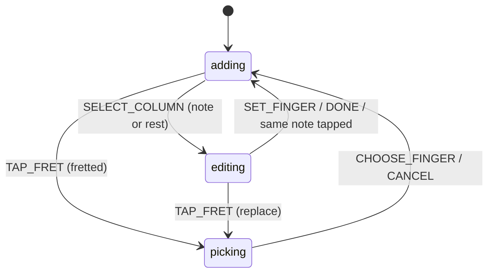

# Fretpad

Write guitar practice tab by tapping the fretboard and choosing the finger you use for each note. Fingers are suggested as you go by following your hand, and you can play it back or loop a section.

## Run it

```sh
npm install
npm run dev      # http://localhost:5173
npm test         # Vitest
npm run typecheck
npm run lint
npm run build    # type-checks, then builds the static site in dist/
```

## Using it

- **Add notes:** tap a fret, then a finger (1–4, T, or none). Open strings go straight in. A finger is suggested (dashed ring; **Enter** takes it) by following your hand: how each finger sits against your last few (one fret apart, rolling across a fret, stretching, shifting). The sheet's fingering system is a light preference on top: **1 finger per fret** keeps your hand's box; **CAGED** (needs a key) favours the key's five scale shapes. `src/music/fingering.benchmark.test.ts` checks it against a real played sheet.
- **Edit:** tap a note in the tab to change its finger or tap a fret to move it. Rings on the neck show the same pitch on other strings, and smaller marks its octaves.
- **Key and mode:** shows the scale on the neck and flags notes outside the key. Key, mode and note value sit under the title as a summary (e.g. "A Dorian · ♪ eighths"); click it to edit them in place. It opens by itself for a sheet with no key and folds back once the mode is picked.
- **Playback:** tempo, note value per column, loop and metronome click. Space plays. When a loop ends on the pitch it starts with (a scale back down to the root), the repeat skips that first note so the root isn't played twice.
- **Loop section:** select a column and press **[** to start a section there or **]** to end it (or use the [ ] buttons by Loop). Play then covers just the section, repeating if Loop is on; **×** clears it. Saved with the sheet.
- **Sheets** menu: switch, add or delete sheets, or start one from a preset (a first visit opens the C major scale; C major scale and A minor pentatonic over two octaves, a C major 1 3 5 7 8 7 5 3 climb up every degree, and the A major I ii vi IV arpeggio run), with fingers set. They save in your browser's local storage. A preset you open and leave without changing anything isn't kept, so browsing presets doesn't pile up sheets. **Export** gives plain-text tab with a fingering row.
- **Measures** (setup line): faint measure lines every 4 beats (4/4), following the note value. Bar lines from older sheets still show and restart the count, but there's no tool to add new ones.

## How the code is organised

React 19 + TypeScript (strict, with `noUncheckedIndexedAccess`) + Vite.

```
src/
  music/        pure domain logic, no React
    types.ts      Note, Finger, Column (notes | rest | bar), Sheet, Key
    theory.ts     tuning, note names, modes, scales
    fingering.ts  finger suggestions: hand model, CAGED shapes
    tab.ts        sheet and column helpers
    presets.ts    ready-made practice sheets
    ascii.ts      plain-text export
  audio/
    synth.ts      Web Audio guitar voice (Karplus-Strong + body EQ + room)
    player.ts     look-ahead playback scheduler
    usePlayback.ts  the one hook that connects them to React
  state/
    editor.ts     the editor state machine (useReducer); Mode and Action unions
    views.ts      view models for the staff and fretboard
    keymap.ts     keyboard shortcuts per mode
    storage.ts    localStorage, reads the prototype's format
  components/   presentational React components (.tsx)
prototype/      the original single-file version, kept for reference
```

### Editor modes

The editor is a reducer with explicit modes. `Mode` and `Action` are discriminated unions, and each mode's handler table is typed against that mode, so handlers get narrowed state. Each mode lists the actions it accepts; anything else is ignored.



Roadmap: [TODO.md](TODO.md).
