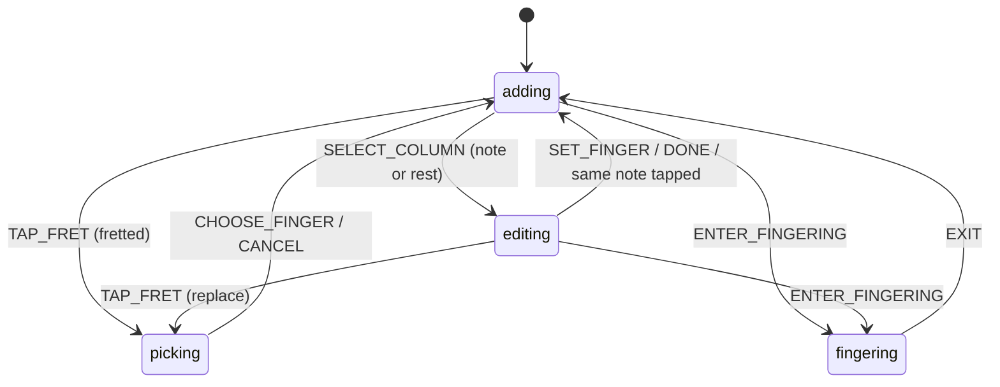

# Fretpad

Write guitar practice tab by tapping the fretboard and choosing the finger you use for each note. Play it back, then re-finger runs with a hand-position tool that keeps every pitch.

## Run it

```sh
npm install
npm run dev      # http://localhost:5173
npm test         # Vitest
npm run typecheck
npm run lint
npm run build    # type-checks, then builds the static site in dist/
```

## Using it

- **Add notes:** tap a fret, then a finger (1–4, T, or none). Open strings go straight in.
- **Edit:** tap a note in the tab to change its finger or tap a fret to move it.
- **Fingering mode** (F): tap the first and last notes of a run, then slide the hand with − / +. Notes keep their pitch, move under your hand and get one finger per fret. Rings show the same pitch on other strings, with the best fit solid.
- **Key and mode:** shows the scale on the neck and flags notes outside the key.
- **Playback:** tempo, note value per column, loop and metronome click. Space plays.
- Sheets save in your browser's local storage. **Export** gives plain-text tab with a fingering row.

## How the code is organised

React 19 + TypeScript (strict, with `noUncheckedIndexedAccess`) + Vite.

```
src/
  music/        pure domain logic, no React
    types.ts      Note, Finger, Column (notes | rest | bar), Sheet, Key
    theory.ts     tuning, note names, modes, scales
    fingering.ts  hand position, fit a run, same-pitch alternatives
    tab.ts        sheet and column helpers
    ascii.ts      plain-text export
  audio/
    synth.ts      Web Audio guitar voice (Karplus-Strong + body EQ + room)
    player.ts     look-ahead playback scheduler
    usePlayback.ts  the one hook that connects them to React
  state/
    editor.ts     the editor state machine (useReducer); Mode and Action unions
    views.ts      view models for the staff and fretboard
    keymap.ts     keyboard shortcuts per mode
    storage.ts    localStorage, reads the prototype's format
  components/   presentational React components (.tsx)
prototype/      the original single-file version, kept for reference
```

### Editor modes

The editor is a reducer with explicit modes. `Mode` and `Action` are discriminated unions, and each mode's handler table is typed against that mode, so handlers get narrowed state. Each mode lists the actions it accepts; anything else is ignored.



Roadmap: [TODO.md](TODO.md).
